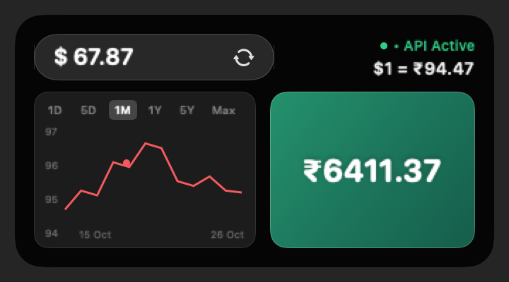

# Fexly ✦

<p align="center">
  
</p>

<p align="center">
  <strong>A premium native macOS DroppyKit utility featuring Apple Liquid Glass styling, real-time Twelve Data forex intelligence, and interactive historical rate trend graphs.</strong>
</p>

<p align="center">
  <a href="https://github.com/NilambarSonu/FEXLY/releases/latest"></a>
  <a href="https://github.com/NilambarSonu/FEXLY/actions/workflows/build.yml"></a>
  
  
  
  <a href="LICENSE"></a>
</p>

---

### [➔ Download Latest Fexly Release](https://github.com/NilambarSonu/FEXLY/releases/latest)

Fexly lives directly inside [Droppy](https://getdroppy.app)’s Dynamic Island and shelf. It delivers dedicated native macOS currency intelligence engineered for financial precision and everyday elegance:

- **Apple Liquid Glass Design**: Frosted translucent backdrops, hairline specular borders, and fluid drag-and-drop palette shortcuts.
- **Historical FX Graph Engine**: Multi-range trend analysis (`1D`, `5D`, `1M`, `1Y`, `5Y`, `Max`) powered by Twelve Data `GET /time_series` with ECB reference fallback, smooth curve interpolation, subtle gridlines, and continuous pointer-aligned hover inspection.
- **Real-Time Forex Intelligence**: Instant conversion between world currencies and Indian Rupees (INR) using live Twelve Data quotes with Apple Keychain security.
- **Honest Provenance & Freshness**: Absolute transparency with verified status tracking (`• API Active`, `Delayed`, `Cached`, `Daily Reference`) so you always know the exact age and origin of every quote.
- **Zero Roundoff Errors**: Pure Decimal-safe financial math preventing floating-point rounding issues.

---

## Visual Showcase

<p align="center">
  
</p>

---

## Key Features

### 🪙 Native Currency Converter & FX History
- **Screen A (Currency Input)**: Clean dark frosted glass canvas, upper-left settings gear, single crisp `• API Active` status indicator, large Liquid Glass search capsule, and interactive draggable currency shortcut cards (`USD`, `INR`, `EUR`, `GBP`, `AED`, `CAD`, `AUD`, `SGD`, `JPY`, `CHF`).
  - **Fluid Palette Reassignment**: Click and drag any shortcut card (e.g. `USD`) to detach a luminous color swatch with zero cursor lag; release over any other currency card to immediately reassign defaults.
- **Screen B (Conversion Result)**:
  - **Editable Source Capsule**: Click to re-edit amount inline or select a new currency code directly from the native Apple dropdown menu without returning to Screen A.
  - **Live Rate Formula**: Displays live exchange equation (e.g. `1 USD = ₹94.0879`).
  - **Historical Trend Chart**: Interactive card with range selectors (`1D`, `5D`, `1M`, `1Y`, `5Y`, `Max`), smooth coral curve, subtle vertical guide line strictly aligned with cursor pointer, and real-time date/rate tooltip badge.
  - **Large Converted Amount Card**: Radiant cyan/teal gradient card displaying bold formatted output (`₹6,411.37`) with one-click copy and instant haptic/visual confirmation.
- **Screen C (Settings Panel)**: Direct Twelve Data API key management with reveal/hide toggle, 3-step setup guide popover, default input currency picker, local target currency picker, and graph enable/disable switch with generous height clearance.
- **Screen D (Notch Live Activity)**: Compact glanceable display showing source amount (`$67.87`) on the leading wing and converted amount (`₹6,411.37`) on the trailing wing with single-line non-wrapping layout that automatically dismisses after 5 seconds.

---

## Installation & Setup

### Requirements
- **macOS**: 14.0 (Sonoma) or macOS 15.0+ (Sequoia)
- **Droppy**: 15.3.0 or later (installed in `/Applications/Droppy.app`)
- **Architecture**: Universal binary (`arm64` Apple Silicon + `x86_64` Intel)

### Step 1: Download the Droplet
Download [`Fexly.droplet.zip`](https://github.com/NilambarSonu/FEXLY/releases/latest) from the latest release and unzip it to obtain `Fexly.droplet`.

### Step 2: Install into Droppy
**Method A (Drag & Drop — Recommended)**:
1. Open Droppy from your menu bar or Applications folder.
2. Open **Settings** (`⌘,`) and navigate to **Droplet Store** (or **Developer**).
3. Drag and drop `Fexly.droplet` into Droppy.
4. Droppy will verify and load Fexly directly into your shelf.

**Method B (Manual Copy)**:
Copy `Fexly.droplet` to your Droppy droplets directory:
```bash
mkdir -p ~/Library/Application\ Support/Droppy/Droplets/fexly
cp -R Fexly.droplet ~/Library/Application\ Support/Droppy/Droplets/fexly/
```
Then restart Droppy:
```bash
killall Droppy && open /Applications/Droppy.app
```

### Step 3: Configure Real-Time Forex (Optional)
Fexly works out of the box using free daily reference rates. To unlock live, minute-by-minute real-time quotes:
1. Get a free API key at [Twelve Data](https://twelvedata.com/pricing) (Free tier: 800 req/day, 8 credits/min).
2. Open **Droppy Settings ➔ Fexly** (or click the gear icon inside Fexly).
3. Paste your key and press Return. Fexly stores it securely in macOS Keychain and immediately activates live quotes (`• API Active`).

---

## Safe Staged Update Instructions

Updating Fexly is safe and completely preserves your Keychain-stored Twelve Data API key and local preferences:

1. **Stage Backup**: Move your current `Fexly.droplet` to `~/.Trash` or create a backup copy:
   ```bash
   cp -R ~/Library/Application\ Support/Droppy/Droplets/fexly/Fexly.droplet ~/Downloads/Fexly-backup.droplet
   ```
2. **Install New Release**: Download and unzip the latest `Fexly.droplet.zip` from [Releases](https://github.com/NilambarSonu/FEXLY/releases/latest), then copy `Fexly.droplet` to your Droppy droplets folder:
   ```bash
   cp -R Fexly.droplet ~/Library/Application\ Support/Droppy/Droplets/fexly/
   ```
3. **Reload Droplet**: Restart Droppy or trigger a droplet reload:
   ```bash
   killall Droppy && open /Applications/Droppy.app
   ```
4. **Automated Rollback**: If the new release fails to initialize for any reason, restore your previous version immediately:
   ```bash
   rm -rf ~/Library/Application\ Support/Droppy/Droplets/fexly/Fexly.droplet
   cp -R ~/Downloads/Fexly-backup.droplet ~/Library/Application\ Support/Droppy/Droplets/fexly/Fexly.droplet
   killall Droppy && open /Applications/Droppy.app
   ```

---

## Architecture & Verification

Fexly is engineered with strict separation between UI and financial domain logic:

```
FEXLY
├── Sources/
│   ├── SkyletCore/                  # Pure financial domain logic (zero host UI dependencies)
│   │   ├── Currency/                # Currency parser, Decimal arithmetic, Twelve Data provider
│   │   └── Security/                # Apple Security framework Keychain manager
│   ├── Skylet/                      # DroppyKit UI & Presentation layer
│   │   ├── Theme/                   # Design tokens (AdaptiveColors, DroppySpacing)
│   │   └── UI/                      # CurrencyView, HistoricalGraphView, SettingsView, SkyletRootView
│   └── SkyletTestsRunner/           # 103 automated unit tests
├── droplet.json                     # DroppyKit manifest (ABI 1, minAPI 1.6.0)
└── .github/workflows/               # CI build & automated release pipelines
```

### Run Automated Tests Locally
Fexly includes 103 automated unit tests covering financial arithmetic precision, parser edge cases, Twelve Data HTTP status codes, Keychain security, and deterministic controllable clock provenance:

```bash
swift run SkyletTestsRunner
```

### DroppyKit Validation
Validate the bundle using DroppyKit's official verification tool:

```bash
./.build/checkouts/droppykit/Scripts/droppykit validate --no-submission
```

---

## Documentation

- [Changelog](CHANGELOG.md) — Complete release history and version notes
- [Release Guide](docs/RELEASE.md) — Packaging and distribution details
- [Architecture](docs/ARCHITECTURE.md) — Deep-dive into Fexly's subsystems
- [Known Limitations](docs/KNOWN_LIMITATIONS.md) — Transparent platform boundaries and trade-offs
- [Testing Guide](docs/TESTING.md) — Test suite layout and mock isolation
- [Privacy Policy](docs/PRIVACY.md) — Zero tracking, local-only credentials

---

## License

Fexly is open-source software released under the [MIT License](LICENSE).
Droppy and DroppyKit are trademarks of their respective owners.
