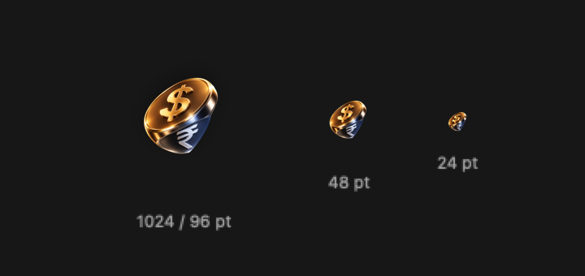

# Skylet ✦

<p align="center">
  
</p>

<p align="center">
  <strong>A premium native macOS DroppyKit utility featuring Figma-faithful currency conversion, live Twelve Data forex intelligence, and interactive historical rate trend graphs.</strong>
</p>

<p align="center">
  <a href="https://github.com/NilambarSonu/SKYLET/releases/latest"></a>
  <a href="https://github.com/NilambarSonu/SKYLET/actions/workflows/build-validate.yml"></a>
  
  
  
  <a href="LICENSE"></a>
</p>

---

### [➔ Download Latest SKYLET Release](https://github.com/NilambarSonu/SKYLET/releases/latest)

Skylet lives directly inside [Droppy](https://getdroppy.app)’s Dynamic Island and shelf. It delivers dedicated native macOS currency intelligence designed around **Figma-Faithful Design & Real-Time Financial Precision**:

- **Figma Design Fidelity**: Charcoal panel (`#414141`), large pale cyan search capsule (`#C4FBFF`), 2 rows of quick currency shortcut chips (`USD`, `INR`, `EUR`, `GBP`, `AED`, `CAD`, `AUD`, `SGD`, `JPY`, `CHF`), source amount pill with swap/refresh rotation, rate formula equation, and large cyan/teal converted amount card.
- **Historical FX Graph Engine**: Multi-range trend analysis (`1D`, `5D`, `1M`, `1Y`, `5Y`, `Max`) powered by Twelve Data `GET /time_series` with fallback to European Central Bank daily reference rates, smooth curve rendering, subtle gridlines, and interactive hover tooltips.
- **Real-Time Forex Intelligence**: Near-instant conversion to Indian Rupees (INR) and world currencies using live Twelve Data quotes with Apple Keychain security, honest quote timestamps, and live notch wing integration.
- **Honest Provenance & Freshness**: Absolute transparency with verified status tracking (`• API Active`, `Delayed`, `Cached`, `Daily Reference`, `Stale`) so you always know the exact age and origin of every quote.
- **Zero Roundoff Errors**: Pure Decimal-safe financial math preventing floating-point rounding issues.

---

## Key Features

### 🪙 Figma-Faithful Currency Converter & FX History
- **Screen A (Currency Input)**: Clean dark charcoal canvas (`#414141`), upper-left settings gear, upper-right verified `• API Active` badge, large pale cyan search pill (`#C4FBFF`) with dark text (`#111827`), and quick currency shortcuts for top global currencies.
- **Screen B (Conversion Result)**:
  - **Source Amount Pill**: Prominent pale cyan pill (`$ 67.87`) with circular arrow swap/refresh button to reverse conversion direction or re-edit.
  - **Live Rate Formula**: Displays live exchange equation (e.g. `$1 = ₹94.47`).
  - **Historical Trend Chart**: Dark card (`#22242A`) with range selectors (`1D`, `5D`, `1M`, `1Y`, `5Y`, `Max`), smooth coral curve, area fill, Y-axis levels, X-axis date stamps, and interactive hover inspection displaying exact rate and date tooltip (`96.34 Mon 5 Oct`).
  - **Large Converted Amount Card**: Radiant cyan/teal gradient card displaying bold formatted output (`₹6411.37`) with one-click copy and instant haptic/visual confirmation.
- **Screen C (Settings Panel)**: Direct API key management with eye reveal/hide toggle, info popover, default input currency picker, local target currency picker, and graph enable/disable switch.
- **Screen D (Notch Live Activity)**: Compact glanceable display showing source amount (`$ 67.87`) on the leading wing and converted amount (`₹6411.37`) on the trailing wing when the cursor leaves the notch.

### 📈 Historical FX Graph Architecture
- **Twelve Data Time Series**: Connects to `GET https://api.twelvedata.com/time_series` with header authentication (`Authorization: apikey ...`) mapping UI ranges to optimal intervals (`15min` for 1D, `1h` for 5D, `1day` for 1M/1Y, `1week` for 5Y, `1month` for Max).
- **Frankfurter ECB Fallback**: Keyless open historical reference rates for daily/weekly/monthly ranges (`1M`, `1Y`, `5Y`, `Max`), with honest rejection of intraday ranges (`1D`, `5D`) when no Twelve Data key is configured.
- **Actor-Based History Cache**: Dedicated memory and disk persistence with interval-tailored TTLs (5m for intraday, 12h for 1M/1Y, 24h for 5Y/Max) and concurrent request deduplication.
- **Graceful Stale Retention**: Never leaves the user with an empty screen during offline periods or provider rate limits.

### 🏝️ Dynamic Island & Shelf Integration
- **Continuous Notch Curvature**: Perfectly shaped with `18pt` shelf and `26.5pt` island radii, eliminating protruding sharp corners.
- **In-Place Currency Picker Overlay**: Layered selection overlay replaces rectangular AppKit modal sheets, maintaining seamless curvature and dark-chrome integration.
- **Dual Surface Layouts**: Full interactive canvas in Solo shelf layout (420pt) and compact glanceable canvas in Paired shelf mode (210pt).
- **Dynamic Island / Notch Live Activity**: Publishes live converted INR amounts and currency symbols in the notch wings.
- **Native Droppy Settings Pane**: Accessible via **Droppy Settings ➔ Skylet** (or in-widget Settings tab) with masked key input, latency tester, and quota notices.

---

## Installation & Setup

### Requirements
- **macOS**: 14.0 (Sonoma) or macOS 15.0+ (Sequoia)
- **Droppy**: 15.3.0 or later (installed in `/Applications/Droppy.app`)
- **Architecture**: Universal binary (`arm64` Apple Silicon + `x86_64` Intel)

### Step 1: Download the Droplet
Download [`Skylet.droplet.zip`](https://github.com/NilambarSonu/SKYLET/releases/latest) from the latest release and unzip it to obtain `Skylet.droplet`.

### Step 2: Install into Droppy
**Method A (Drag & Drop — Recommended)**:
1. Open Droppy from your menu bar or Applications folder.
2. Open **Settings** (`⌘,`) and navigate to **Droplet Store** (or **Developer**).
3. Drag and drop `Skylet.droplet` into Droppy.
4. Droppy will verify and load Skylet directly into your shelf.

**Method B (Manual Copy)**:
Copy `Skylet.droplet` to your Droppy droplets directory:
```bash
mkdir -p ~/Library/Application\ Support/Droppy/Droplets/skylet
cp -R Skylet.droplet ~/Library/Application\ Support/Droppy/Droplets/skylet/
```
Then restart Droppy:
```bash
killall Droppy && open /Applications/Droppy.app
```

### Step 3: Configure Real-Time Forex (Optional)
Skylet works out of the box using free daily reference rates. To unlock live, minute-by-minute real-time quotes:
1. Get a free API key at [Twelve Data](https://twelvedata.com/pricing) (Free tier: 800 req/day, 8 credits/min).
2. Open **Droppy Settings ➔ Skylet** (or open Skylet and switch to the **Settings** tab).
3. Paste your key and click **Test Connection** to confirm connectivity.
4. Click **Save Key**. Skylet will store it securely in macOS Keychain and immediately activate real-time quotes.

---

## Safe Staged Update Instructions

Updating Skylet is safe and completely preserves your Keychain-stored Twelve Data API key and local preferences. Follow this staged replacement procedure to ensure zero downtime and instant rollback capability:

1. **Stage Backup**: Move your current `Skylet.droplet` to `~/.Trash` or create a backup copy:
   ```bash
   cp -R ~/Library/Application\ Support/Droppy/Droplets/skylet/Skylet.droplet ~/Downloads/Skylet-backup.droplet
   ```
2. **Install New Release**: Download and unzip the latest `Skylet.droplet.zip` from [Releases](https://github.com/NilambarSonu/SKYLET/releases/latest), then copy `Skylet.droplet` to your Droppy droplets folder:
   ```bash
   cp -R Skylet.droplet ~/Library/Application\ Support/Droppy/Droplets/skylet/
   ```
3. **Reload Droplet**: Restart Droppy or trigger a droplet reload:
   ```bash
   killall Droppy && open /Applications/Droppy.app
   ```
4. **Automated Rollback**: If the new release fails to initialize for any reason, restore your previous version immediately:
   ```bash
   rm -rf ~/Library/Application\ Support/Droppy/Droplets/skylet/Skylet.droplet
   cp -R ~/Downloads/Skylet-backup.droplet ~/Library/Application\ Support/Droppy/Droplets/skylet/Skylet.droplet
   killall Droppy && open /Applications/Droppy.app
   ```

---

## Architecture & Verification

Skylet is engineered with strict separation between UI and financial domain logic:

```
SKYLET
├── Sources/
│   ├── SkyletCore/                  # Pure domain logic (zero host UI dependencies)
│   │   ├── Currency/                # Currency parser, Decimal arithmetic, Twelve Data provider
│   │   └── Security/                # Apple Security framework Keychain manager
│   ├── Skylet/                      # DroppyKit UI & Presentation layer
│   │   ├── Theme/                   # SkyletTheme design tokens (AdaptiveColors, DroppySpacing)
│   │   └── UI/                      # CurrencyView, CurrencySelectorView, SettingsView, SkyletRootView
│   └── SkyletTestsRunner/           # 81 automated unit tests
├── droplet.json                     # DroppyKit manifest (ABI 1, minAPI 1.6.0)
└── .github/workflows/               # CI build & automated release pipelines
```

### Visual Preview & Screenshots

<p align="center">
  
</p>

### Run Automated Tests Locally
Skylet includes 81 automated unit tests covering financial arithmetic precision, parser edge cases, Twelve Data HTTP status codes, Keychain security, and deterministic controllable clock provenance:

```bash
swift run SkyletTestsRunner
```

### DroppyKit Validation
Validate the bundle using DroppyKit's official verification tool:

```bash
./.build/checkouts/droppykit/Scripts/droppykit validate --no-submission
```

---

## Documentation

- [Changelog](CHANGELOG.md) — Complete release history and version notes
- [Release Guide](docs/RELEASE.md) — Packaging and distribution details
- [Architecture](docs/ARCHITECTURE.md) — Deep-dive into Skylet's subsystems
- [Known Limitations](docs/KNOWN_LIMITATIONS.md) — Transparent platform boundaries and trade-offs
- [Testing Guide](docs/TESTING.md) — Test suite layout and mock isolation
- [Privacy Policy](docs/PRIVACY.md) — Zero tracking, local-only credentials

---

## License

Skylet is open-source software released under the [MIT License](LICENSE).
Droppy and DroppyKit are trademarks of their respective owners.
