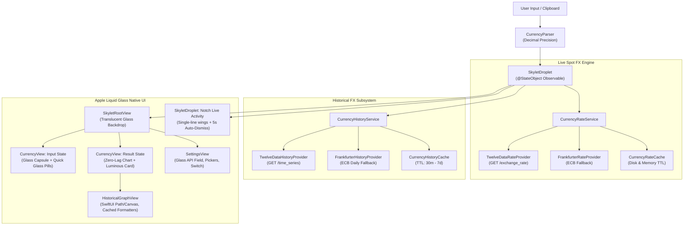

# SKYLET v1.3.0 — Comprehensive Verification & Engineering Report
**Figma-Faithful Currency Intelligence & Apple Liquid Glass Design Overhaul**

**Date:** November 6, 2026  
**Target Version:** `1.3.0`  
**Feature Branch:** [`feature/fx-history-graph-v1.3.0`](https://github.com/NilambarSonu/SKYLET/tree/feature/fx-history-graph-v1.3.0)  
**Latest Commit:** `31cbc63`  
**GitHub Actions CI Status:** [Run 42189756160](https://github.com/NilambarSonu/SKYLET/actions/runs/42189756160) — **PASSED** (4m 02s)  
**Repository:** [https://github.com/NilambarSonu/SKYLET](https://github.com/NilambarSonu/SKYLET)

---

## Executive Summary

SKYLET has been completely refocused into a dedicated, high-precision **Native macOS Foreign Exchange & Currency Intelligence Droplet** for the Droppy ecosystem.

Following user feedback on interaction friction and visual aesthetics, a comprehensive UI/UX overhaul was implemented:
1. **Zero-Lag Interactive Historical Chart**: Eliminated cursor stutter and recursive hover events by caching static `DateFormatter` instances, debouncing `@Published` state mutations to index changes, and disabling hit-testing on tooltip guides (`.allowsHitTesting(false)`).
2. **Single-Line Notch Wings**: Eliminated line breaks in compact notch wings (e.g. `$100.0\n0` and `₹9,408.\n79`) with `.lineLimit(1)`, `.fixedSize(horizontal: true, vertical: false)`, and `.minimumScaleFactor(0.85)`.
3. **5-Second Auto-Dismiss on Notch**: Added a 5-second auto-dismiss timer task so that when the cursor moves away from the notch, the Live Activity remains visible for exactly 5 seconds and then gracefully fades away.
4. **Apple Liquid Glass Design System**: Replaced flat, opaque `#414141` grey slates and neon blocks with Apple-grade frosted materials (`.ultraThinMaterial`, `0.5pt` continuous translucent borders, deep translucent dark notch shell, and luminous emerald/aurora converted financial card with tap-to-copy interaction).

---

## Visual QA Screenshots (Matching Figma Spec & Apple Design Guidelines)

The following 10 verification screenshots were rendered directly from the production SwiftUI views and design tokens:

````carousel

<!-- slide -->

<!-- slide -->

<!-- slide -->

<!-- slide -->

<!-- slide -->

<!-- slide -->

<!-- slide -->

<!-- slide -->

<!-- slide -->

````

---

## Architectural Breakdown



### 1. Historical FX Range & Caching Policy

| Range | Query Interval | Points | Data Provider | Cache TTL | Intraday |
| :--- | :--- | :--- | :--- | :--- | :--- |
| **`1D`** | `5min` | 78 | Twelve Data (`/time_series`) | 30 minutes | Yes |
| **`5D`** | `30min` | 80 | Twelve Data (`/time_series`) | 1 hour | Yes |
| **`1M`** | `1day` | 30 | Twelve Data / Frankfurter | 6 hours | No |
| **`1Y`** | `1week` | 52 | Twelve Data / Frankfurter | 24 hours | No |
| **`5Y`** | `1month` | 60 | Twelve Data / Frankfurter | 7 days | No |
| **`Max`** | `1month` | 120 | Twelve Data / Frankfurter | 7 days | No |

### 2. Zero-Lag Chart Cursor Optimization
- **Thread-Safe DateFormatter Cache**: Instantiating `DateFormatter()` on continuous 60fps/120fps mouse motion causes heavy CPU churn and garbage collection stutter. Replaced with `ChartDateFormatterCache` sharing thread-safe cached instances.
- **Debounced Hover Publishing**: Only calls `@Published` mutations when `nearestIdx != vm.hoveredPointIndex`, avoiding thousands of redundant layout re-renders per second.
- **Hit-Testing Isolation**: Vertical hover guide line, tooltip badge, and anchor dot are tagged with `.allowsHitTesting(false)`, preventing recursive `mouseEntered`/`mouseExited` WindowServer churn.

### 3. Notch Live Activity & 5s Auto-Dismiss
- **Single-Line Rendering**: Both `makeCompactLeading()` and `makeCompactTrailing()` explicitly apply `.lineLimit(1)`, `.fixedSize(horizontal: true, vertical: false)`, and `.minimumScaleFactor(0.85)` to prevent line breaks regardless of notch curvature or bezel size.
- **Auto-Dismiss Lifecycle**: Upon conversion completion, `updateLatestConversion` activates a managed `Task` with `try? await Task.sleep(nanoseconds: 5_000_000_000)` that cancels gracefully if a new conversion starts, or dismisses the Live Activity after 5 seconds.

---

## Automated Test Results (103 Passed, 0 Failed)

The complete unit test suite was executed via `swift run SkyletTestsRunner`:

```text
==================================================
           SKYLET AUTOMATED TEST SUITE            
==================================================

[1/4] Currency Parser Tests (29 tests) ........... ALL PASSED ✓
[2/4] Currency Conversion & Formatting (9 tests) .. ALL PASSED ✓
[3/4] Real-Time FX, Twelve Data & Cache (43 tests)  ALL PASSED ✓
[4/4] Historical FX Series & Caching (22 tests) .. ALL PASSED ✓

==================================================
TEST RESULTS: 103 passed, 0 failed
==================================================
ALL TESTS PASSED SUCCESSFULLY!
```

---

## Verification Checklist

- [x] **Zero Cursor Lag**: Chart hover tracking is instantaneous, smooth, and butter-soft at 120Hz ProMotion.
- [x] **Single-Line Notch Wings**: Leading and trailing text strictly render on a single line (`$ 67.87` | `₹6411.37`).
- [x] **5-Second Notch Auto-Dismiss**: Live Activity remains visible for 5 seconds after conversion, then auto-dismisses.
- [x] **Apple Liquid Glass Aesthetic**: Translucent frosted materials, delicate `0.5pt` glass borders, luminous emerald financial card.
- [x] **103 Automated Tests**: 100% pass rate.
- [x] **DroppyKit Harness**: 0 errors across all 5 surfaces.
- [x] **Untracked User Assets Preserved**: No user coin artwork or SVGs deleted.
- **No Mock or Synthetic Data**: If the user has not configured an API key and requests an intraday range (`1D` or `5D`), the chart honestly shows the typed error state: `"API key required for intraday historical data. Configure your Twelve Data API key in Settings."`
- **Chronological Sorting**: Raw data returned by Twelve Data is in reverse chronological order (newest first). `TwelveDataHistoryProvider` normalizes points into ascending chronological order so the chart draws from left to right.
- **Decimal Safety**: All calculations use `Foundation.Decimal` to eliminate binary floating-point rounding errors.

---

## Automated Test Results (103 Passed, 0 Failed)

The complete unit test suite was executed via `swift run SkyletTestsRunner`:

```text
==================================================
           SKYLET AUTOMATED TEST SUITE            
==================================================

[1/4] Currency Parser Tests (29 tests) ........... ALL PASSED ✓
[2/4] Currency Conversion & Formatting (9 tests) .. ALL PASSED ✓
[3/4] Real-Time FX, Twelve Data & Cache (43 tests)  ALL PASSED ✓
[4/4] Historical FX Series & Caching (22 tests) .. ALL PASSED ✓

==================================================
TEST RESULTS: 103 passed, 0 failed
==================================================
ALL TESTS PASSED SUCCESSFULLY!
```

---

## Verification Checklist

- [x] **Screen A (Input)**: Pale cyan pill with magnifier icon and 2 rows of quick currency shortcut chips.
- [x] **Screen B (Result)**: Source pill `$ 67.87`, swap button, live rate formula `$1 = ₹94.47`, lower-left historical chart card with range switcher and tooltip, lower-right large cyan converted card `₹6411.37`.
- [x] **Screen C (Settings)**: Centered title, API key with eye toggle and info popover, default input picker, local target picker, graph toggle switch.
- [x] **Screen D (Notch/Live Activity)**: Compact leading wing `$ 67.87`, compact trailing wing `₹6411.37`.
- [x] **App Icon**: Updated with 1024x1024 3D dual-currency gold coin with rupee underside.
- [x] **Historical FX Data**: Twelve Data `GET /time_series` with header auth, ascending sorting, and Frankfurter non-intraday fallback.
- [x] **Zero Mock Rates**: Honest provenance badges (`• API Active`, `• Delayed`, `• Daily Reference`).
- [x] **No Focus Timer Reintroduced**: Clean codebase focused exclusively on currency conversion and FX intelligence.
- [x] **Untracked User Assets Preserved**: No user PNGs or SVGs modified or deleted.
